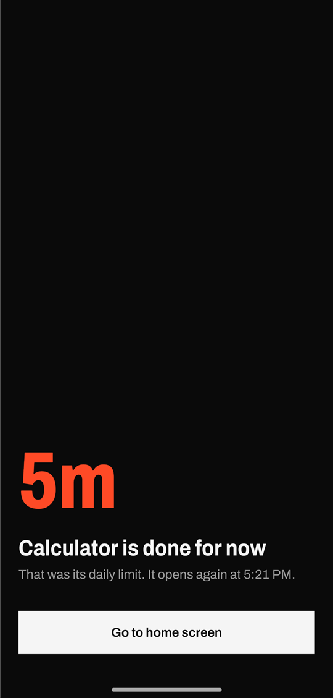
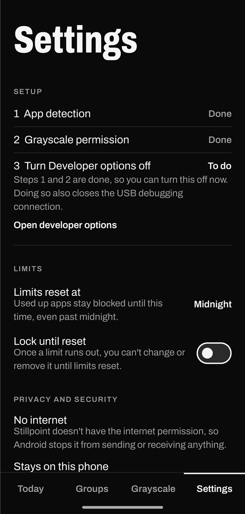

# Stillpoint

Daily app limits, shared limits across groups of apps, and grayscale that switches on only for the
apps you choose. For Android, open source, and with no internet access at all.

<p>
  
  
</p>

## What it does

- **App limits:** give an app a daily limit. When the time runs out, a full-screen stop page covers
  it until limits reset.
- **Groups:** apps in a group share one limit. Time in any of them counts against the same total,
  and when it runs out they all stop.
- **Per-app grayscale:** pick apps from a list. The screen turns gray while one of them is open and
  goes back to normal colours as soon as you switch away. This is the feature I couldn't find
  elsewhere, and the reason this project started.
- **Your own reset time:** limits reset at midnight by default, or any minute you choose. With a
  6:00 AM reset, an app you used up at 11 PM stays blocked until 6:00 AM.
- **Optional lock:** once a limit runs out, you can't change or remove it until limits reset.

Inspired by [Mindful](https://github.com/akaMrNagar/Mindful), which I recommend looking at. Stillpoint
is a separate app with its own code, and isn't affiliated with that project.

## Project status

Early, and looking for feedback. It has been tested on **one phone: a OnePlus on Android 16, in dark
mode**. Other brands and light mode are untested, and reports from them are the most useful thing
you can send.

## Install

1. Download `app-release.apk` from [Releases](../../releases).
2. Turn on **Developer options > USB debugging**, connect your phone to a computer with
   [adb](https://developer.android.com/tools/releases/platform-tools), then install it:

   ```bash
   adb install -r app-release.apk
   ```

3. Allow grayscale. Android doesn't let an app ask for this permission on the phone itself, so this
   step needs a computer, once per install. Skip it if you only want limits.

   ```bash
   adb shell pm grant com.stillpoint.app android.permission.WRITE_SECURE_SETTINGS
   ```

   On OnePlus, Oppo and Realme this can fail with a `SecurityException`. Turn on **Developer options
   > Disable permission monitoring**, restart the phone and run it again.

4. Open Stillpoint, go to **Settings**, and turn on its accessibility service.
5. Turn Developer options off, then check that steps 1 and 2 in the Settings tab still say Done.

Installing with `adb` avoids Android's "restricted setting" block on accessibility services. If you
install by tapping the APK and the toggle is grayed out, go to **App info > ⋮ > Allow restricted
settings**.

## Permissions and privacy

This app asks for a lot of trust, so here is exactly what it does with it.

| Permission | Why | Limit on it |
|---|---|---|
| Accessibility service | Knows which app is open, so it can count time and apply your rules | `canRetrieveWindowContent` is off, so it can't read the screen, what you type or your messages |
| `WRITE_SECURE_SETTINGS` | Switches Android's colour filter | Powerful in general, but the code writes only the two colour filter settings, in [`GrayscaleController`](app/src/main/java/com/stillpoint/app/service/GrayscaleController.kt) |
| `QUERY_ALL_PACKAGES` | Lists your apps so you can pick them | Stays on the phone |

- **No internet.** The [manifest](app/src/main/AndroidManifest.xml) removes the `INTERNET` permission,
  so Android itself blocks the app from sending or receiving anything. There's no analytics, no
  accounts and no ads.
- **Your data stays on the phone.** Limits and usage are stored only in the app's private storage,
  and are excluded from cloud backup and device transfer.
- **Nothing to call into.** The launcher screen is the only part other apps can open.

To take the grayscale permission back without uninstalling:

```bash
adb shell pm revoke com.stillpoint.app android.permission.WRITE_SECURE_SETTINGS
```

## Good to know

- Time is counted only while the phone is unlocked with the app in front, starting when the
  accessibility service is turned on. Background audio isn't counted.
- This is a tool for self-control, not a parental control. Turning off the accessibility service
  stops all limits, even with the lock on.
- Changing the reset time keeps time already used, and it can't be changed while a limit is locked.
- If you already use Android's colour correction, your setting is saved and put back when a grayscale
  app closes.
- If you uninstall while the screen is gray, turn it off in **Settings > Accessibility > Colour
  correction**.
- If limits stop counting after a while, your phone's battery manager may be stopping the service.
  Set Stillpoint's battery use to unrestricted.

## Build

Requires JDK 17 and the Android SDK (platform 35).

```bash
./gradlew testDebugUnitTest assembleDebug
```

## Contributing

Suggestions and pull requests are welcome, including ideas for what to remove. See
[CONTRIBUTING.md](CONTRIBUTING.md). Please report security problems privately, as described in
[SECURITY.md](SECURITY.md).

## License

[GPL-3.0](LICENSE). The Archivo font is under the
[SIL Open Font License](app/src/main/assets/fonts/OFL-Archivo.txt).
